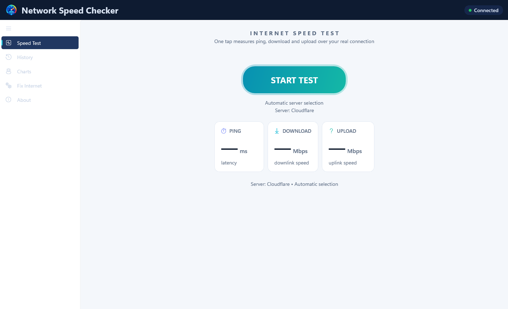

# Network Speed Checker

<p align="center">
  <strong>A modern, fast, and lightweight internet speed test & network diagnostics desktop application for Windows.</strong>
</p>

<p align="center">
  <a href="https://github.com/uponatime2019/NetworkSpeedChecker/releases/latest"></a>
  
  
  
  <a href="LICENSE"></a>
</p>

---

## ⚡ Try It Now (Zero Install, Portable)

Ready to test your connection in seconds without installation?

👉 **[Download the Latest Standalone Release](https://github.com/uponatime2019/NetworkSpeedChecker/releases/latest)**

1. Download `NetworkSpeedChecker-v1.0.0-win-x64.zip`.
2. Extract the ZIP anywhere on your PC.
3. Double-click `NetworkSpeedChecker.exe` to run. No installer or runtime setup required!

---

## 📸 Screenshot



---

## ✨ Key Features

- **🚀 One-Tap Speed Testing**: Accurate measurements of download throughput, upload rate, ping latency, and jitter.
- **☁️ Cloudflare Global Edge**: Leverages Cloudflare's ultra-low latency worldwide edge network for realistic, reliable speed benchmarks.
- **📊 Historical Trends & Charts**: Automatically saves completed test results locally on your device with interactive trend charts.
- **🔧 Fix Internet & Diagnostics**: Built-in network diagnostic scan, DNS cache flushing utility, and Wi-Fi 2.4 GHz vs. 5 GHz band advisor.
- **🔒 Privacy First & Local Only**: Zero telemetry, zero tracking, no accounts required. All test histories remain private on your computer.
- **🎨 Windows 11 Fluent Design**: Native WinUI 3 interface with Mica material backdrop, responsive navigation, and Dark/Light theme adaptation.
- **📦 Fully Standalone & Portable**: Pure unpackaged WinUI 3 architecture with self-contained dependencies—run it directly from any drive or USB key.

---

## 🏗️ Architecture & Technology Stack

| Component | Technology | Description |
|---|---|---|
| **UI Framework** | [WinUI 3](https://learn.microsoft.com/windows/apps/winui/winui3/) | Native Windows App SDK modern UI controls |
| **Language & Runtime** | C# 12 / .NET 8.0 | High-performance managed runtime targeting Windows 10/11 |
| **Measurement Engine** | Cloudflare Edge Endpoints | Real HTTP/2 multi-stream transfer chunks |
| **Data Persistence** | Local JSON File Store | Stored securely in `%LocalAppData%\NetworkSpeedChecker` |
| **Styling & Theming** | XAML Styles & Brushes | Custom palette with Mica backdrop support |
| **Deployment** | Self-Contained Unpackaged | Portable executable with zero system-wide prerequisites |

---

## ⌨️ Keyboard Shortcuts & Controls

| Shortcut / Key | Context | Action |
|---|---|---|
| <kbd>Enter</kbd> / <kbd>Space</kbd> | Speed Test | Start test (when Start button is focused) |
| <kbd>Esc</kbd> | Speed Test | Cancel active speed test |
| <kbd>Ctrl</kbd> + <kbd>C</kbd> | History / Speed Test | Copy formatted result summary to clipboard |
| <kbd>Alt</kbd> + <kbd>F4</kbd> | Application | Close application |

---

## 🔨 Building from Source

### Prerequisites
- Windows 10 (version 1809+) or Windows 11
- [.NET 8.0 SDK](https://dotnet.microsoft.com/download/dotnet/8.0)
- [Visual Studio 2022](https://visualstudio.microsoft.com/) (17.8+) with:
  - **.NET Desktop Development** workload
  - **Windows App SDK C# Templates**

### Build & Run

Clone the repository and build using the .NET CLI:

```powershell
# Clone the repository
git clone https://github.com/uponatime2019/NetworkSpeedChecker.git
cd NetworkSpeedChecker

# Build the project (x64)
dotnet build NetworkSpeedChecker.csproj -p:Platform=x64

# Run the app
dotnet run --project NetworkSpeedChecker.csproj
```

### Self-Contained Portable Publish

To compile a standalone portable binary:

```powershell
dotnet publish NetworkSpeedChecker.csproj -c Release -p:Platform=x64 -o publish/NetworkSpeedChecker_Portable
```

---

## 🗺️ Roadmap

- [x] Accurate Ping, Jitter, Download, and Upload measurement engine
- [x] Local JSON-backed test history log
- [x] Interactive bar charts and trend visualizations
- [x] Network diagnostics and DNS cache flush tool
- [x] Standalone unpackaged CI/CD release automation
- [ ] Export history to CSV and JSON formats
- [ ] Custom speed-test server selection and custom endpoint URLs
- [ ] Tray icon minimize & background periodic speed monitoring
- [ ] Multi-language localization (i18n)

---

## 🤝 Contributing & Community

Contributions are what make the open-source community such an amazing place to learn, inspire, and create. Any contributions you make are **greatly appreciated**!

- 🐛 **Report Bugs**: Check the [Issues](https://github.com/uponatime2019/NetworkSpeedChecker/issues) tab to report unexpected behavior.
- 💡 **Suggest Features**: Share your ideas for new diagnostics or UI enhancements.
- 🔀 **Pull Requests**: Review [CONTRIBUTING.md](CONTRIBUTING.md) to get started on submitting code changes.

---

## 📄 License

Distributed under the **MIT License**. See [`LICENSE`](LICENSE) for more information.
